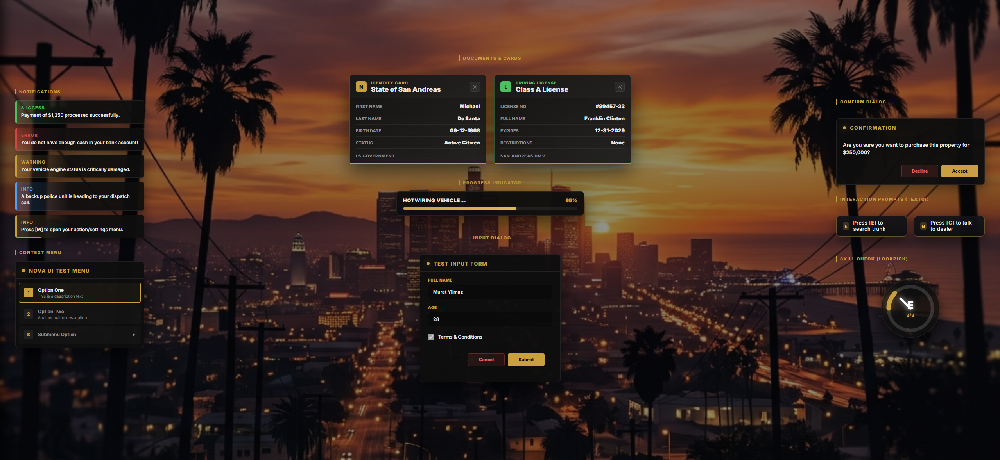

# nova-ui

> Standalone, framework-free UI layer for FiveM: notifications, confirm dialogs,
> progress bars, document cards, context menus, input dialogs, and lockpick skillchecks.
> Supports built-in automatic bridging for popular resources. TR/EN built in.

---



## English

### What it does
A shared, reusable UI library exposed through client-side exports and events. It has **no dependencies** (not even a framework), so it runs anywhere. Features:
- **Notifications** — toast notifications with tone (info / success / error / warning), title, message, and a timed bar.
- **Confirm** — a yes/no modal with callbacks and a timeout. Supports turning into a single-button **Alert Dialog** if `rejectLabel` is omitted.
- **Progress** — a progress bar with optional animation and control locking, plus finish/cancel callbacks.
- **Document card** — a styled ID/registration-style card (badge, title, fields, footer).
- **Context Menu** — vertical interactive menus supporting icons, descriptions, nested submenus, and full keyboard navigation (Arrow keys + Enter + ESC).
- **Input Dialog** — thread-blocking popup forms supporting text inputs, passwords, numbers, select dropdowns, and checkboxes.
- **Skill Check** — sleek circular SVG spinner mini-game. Supports custom key binds (E, R, Q, F, SPACE), movement during play, and **multiple consecutive stages** (e.g. Easy -> Medium -> Hard) with an interactive progress counter.
- **Synthesized Audio** — dynamic, self-contained chimes generated via NUI **Web Audio API** (no sound files needed).
- **Automatic Bridge** — auto-intercepts notifications and TextUIs sent from `ox_lib`, `QBCore`, `ESX Legacy`, and `okokNotify`, instantly displaying them in the elegant Nova UI theme with zero code changes.

### Dependencies
**None.** Pure standalone resource.

### Installation
1. Drop the `nova-ui` folder into your `resources` (e.g. `resources/[standalone]/`).
2. Add `ensure nova-ui` to your `server.cfg` (load it **before** scripts that use it).
3. Restart your server.

### Configuration — `shared/config.lua`
| Option | Description |
| --- | --- |
| `Config.Locale` | Built-in string language: `'en'` or `'tr'`. |
| `Config.PlaySounds` | Toggle synthesized NUI sound effects: `true` or `false`. |
| `Config.Brand.badge` | Default badge (1–2 letters) on document cards. |
| `Config.Brand.footer` | Default footer text on document cards. |
| `Config.Locales` | Custom translations for headers, locales, and default text. |

### Exports (Client-side)

#### Notifications
```lua
exports['nova-ui']:Notify('Operation completed.', 'success') -- message, type, duration?
exports['nova-ui']:Notify({ title = 'Bank', message = 'Payment received', type = 'info', duration = 5000 })
```

#### Confirm Dialog (or Alert Dialog)
```lua
-- Standard two-button confirmation
exports['nova-ui']:Confirm({
  title = 'Purchase Vehicle?',
  message = 'This will cost $25,000.',
  acceptLabel = 'Buy',
  rejectLabel = 'Cancel',
  timeout = 15000,
}, function(accepted)
  if accepted then print('bought') else print('cancelled') end
end)

-- Alert Mode: pass rejectLabel = false or nil to display only a single "Ok" button
exports['nova-ui']:Confirm({
  title = 'Access Denied',
  message = 'You do not have the required keycard.',
  acceptLabel = 'Close',
  rejectLabel = false,
})
```

#### Progress Bar
```lua
exports['nova-ui']:Progress({
  label = 'Hotwiring vehicle...',
  duration = 5000,
  canCancel = true,
  disableControls = { disableMovement = true, disableCombat = true },
  animation = { animDict = 'anim@amb@clubhouse@tutorial@bkr_tut_ig3@', anim = 'machinic_loop_mechand' },
}, function(completed)
  if completed then print('vehicle started!') else print('failed') end
end)
```

#### Document Card
```lua
exports['nova-ui']:ShowDocument({
  type = 'id', -- 'id' (gold accent) or 'registration' (green accent)
  badge = 'LS',
  kicker = 'IDENTITY CARD',
  title = 'State of San Andreas',
  footer = 'LS City Hall',
  fields = {
    { label = 'First Name', value = 'Michael' },
    { label = 'Last Name', value = 'De Santa' },
    { label = 'Status', value = 'Active Citizen' },
  },
})
```

#### Context Menu
```lua
-- Register your menu configurations (supports icons, descriptions, and submenu indicators)
exports['nova-ui']:RegisterMenu({
  id = 'main_interaction_menu',
  title = 'Vehicle Actions',
  options = {
    { label = 'Inspect Engine', desc = 'Check engine status', icon = '1', event = 'car:client:inspect' },
    { label = 'Locksmith Tools', desc = 'Open lockpicking kit', icon = 'L', arrow = true, event = 'car:client:submenu' }
  }
})

exports['nova-ui']:RegisterMenu({
  id = 'locksmith_submenu',
  title = 'Lockpicking Kit',
  options = {
    { label = 'Force Lockpick', desc = 'Attempts lockpick check', icon = 'F', event = 'car:client:startLockpick' },
    { label = 'Back', desc = 'Go back to main options', icon = 'B', event = 'car:client:backToMain' }
  }
})

-- Display the menu
exports['nova-ui']:ShowMenu('main_interaction_menu')

-- Navigate submenus smoothly without NUI focus flicker:
AddEventHandler('car:client:submenu', function()
    exports['nova-ui']:ShowMenu('locksmith_submenu')
end)

AddEventHandler('car:client:backToMain', function()
    exports['nova-ui']:ShowMenu('main_interaction_menu')
end)
```

#### Input Dialog
```lua
-- Blocks the current execution thread and yields/returns input values synchronously in a table
CreateThread(function()
    local data = exports['nova-ui']:InputDialog('Register Business', {
        { type = 'text', label = 'Business Name', placeholder = 'Enter name...', required = true },
        { type = 'number', label = 'Starting Capital ($)', placeholder = '10000' },
        { type = 'select', label = 'Category', options = {
            { value = 'mechanic', label = 'Mechanic Workshop' },
            { value = 'club', label = 'Night Club' }
        }},
        { type = 'checkbox', label = 'I accept terms and conditions' }
    })
    
    if data then
        local name = data[1]
        local capital = data[2]
        local category = data[3]
        local acceptedTerms = data[4] -- returns boolean
        print(('Registered %s as %s'):format(name, category))
    else
        print('User cancelled form input.')
    end
end)
```

#### Skill Check (Lockpick)
```lua
-- Blocks thread and returns true/false. Allows character movement while active.
CreateThread(function()
    -- Single-stage check
    local success = exports['nova-ui']:SkillCheck('medium', 'E')
    
    -- Multi-stage check (3 consecutive stages: Easy -> Medium -> Hard)
    local successSequence = exports['nova-ui']:SkillCheck({'easy', 'medium', 'hard'}, 'E')
    
    if successSequence then
        print('Successfully bypassed lock!')
    else
        print('Lockpick failed!')
    end
end)
```

### Emergency Bypass
If a developer error or script crash locks NUI mouse focus, players can open their **F8 Console** and type:
`releasefocus`
This command immediately unlocks NUI focus, clears mouse captures, and closes active menus, dialogs, or documents.

---

## Türkçe

### Ne işe yarar?
İstemci tarafı (client) export ve event'ler aracılığıyla sunulan, paylaşılan ve yeniden kullanılabilir bir UI kütüphanesi. **Hiçbir bağımlılığı yoktur** (framework bağımsızdır), her pakette çalışır. Özellikler:
- **Bildirimler** — tonlu (info / success / error / warning), başlık + mesaj + süreli çubuk içeren bildirim kartları.
- **Confirm** — geri çağırmalı (callback) ve zaman aşımlı onay kutusu. `rejectLabel = false` veya `nil` girildiğinde tek butonlu **Alert Dialog (Uyarı/Bilgilendirme)** moduna geçer.
- **Progress** — opsiyonel animasyonlu, iptal edilebilir ve kontrol kilitli ilerleme çubuğu.
- **Belge Kartı** — kimlik/ruhsat tarzı özelleştirilebilir şık kart tasarımı (rozet, başlık, veri tablosu, alt metin).
- **Açılır Menü (Context Menu)** — yön tuşları, Enter ve ESC ile kontrol edilen dikey etkileşim menüleri. Alt menüler arası geçişlerde ekran titremesi (flicker) yapmaz.
- **Veri Girişi (Input Dialog)** — yazı, şifre, sayı, açılır liste (select) ve onay kutusu (checkbox) içeren thread-blocking form pencereleri.
- **Skill Check (Yetenek Oyunu)** — dairesel dönen ibre oyunu. Karakter hareket halindeyken oynanabilir ve **ardışık çoklu aşama (örneğin Kolay -> Orta -> Zor)** desteği sunar.
- **Sentezlenmiş Sesler** — NUI **Web Audio API** ile doğrudan tarayıcıda sentezlenen ses efektleri (harici ses dosyası gerektirmez).
- **Otomatik Entegrasyon Köprüsü** — Sunucudaki diğer scriptlerin `ox_lib`, `QBCore`, `ESX Legacy` ve `okokNotify` üzerinden gönderdiği bildirimleri ve TextUI pencerelerini otomatik olarak yakalar ve Nova UI stilinde görüntüler.

### Kurulum
1. `nova-ui` klasörünü `resources` içine atın (örn. `resources/[standalone]/`).
2. `server.cfg` dosyanıza `ensure nova-ui` ekleyin (bu arayüzü kullanan scriptlerden **önce** yüklenmelidir).
3. Sunucuyu yeniden başlatın.

### Ayarlar — `shared/config.lua`
| Ayar | Açıklama |
| --- | --- |
| `Config.Locale` | Hazır metinlerin varsayılan dili: `'en'` veya `'tr'`. |
| `Config.PlaySounds` | Yapay NUI ses efektleri: `true` (aktif) veya `false` (kapalı). |
| `Config.Brand.badge` | Belge kartındaki varsayılan rozet (1–2 harf). |
| `Config.Brand.footer` | Belge kartındaki varsayılan alt metin. |
| `Config.Locales` | Dile göre başlıklar, yerelleştirme metinleri ve varsayılan etiketler. |

### Export Örnekleri (LUA)

Kullanım kalıpları (Context Menu kaydetme, Input Dialog coroutine yapısı, Skill Check çoklu aşama döngüleri ve Confirm tek butonlu bildirim modu) yukarıdaki İngilizce (**Exports**) bölümünde detaylı kod bloklarıyla listelenmiştir.

### Acil Durum Kurtarma
Herhangi bir yazılımsal çökme veya geliştirici hatası nedeniyle farenizin ekranda kilitli kalması durumunda, klavyenizden **F8** tuşuna basıp konsola:
`releasefocus`
yazarak tüm arayüz odaklarını ve kilitleri anında kaldırabilirsiniz.

---

**Author:** Nova · **Version:** 1.1.0 · **Type:** Standalone UI library
